# Diagrama entidad-relación — Ruta Contable

Generado desde el catálogo de PostgreSQL con `docs/bd/genera_er.sql`. No se edita a mano: se regenera después de cada migración. 35 tablas y 62 relaciones (FK). Cada relación lleva como etiqueta la columna FK de la tabla hija. Detalle de columnas, tipos completos y restricciones: `docs/bd/diccionario.md`.

```mermaid
erDiagram
  admin_perfil {
    integer user_id PK, FK
    varchar cargo
    jsonb permisos
    integer creado_por FK
    timestamp created_at
    timestamp updated_at
  }
  alerta_sistema {
    integer id PK
    varchar tipo
    text mensaje
    jsonb detalle
    boolean leida
    timestamp created_at
  }
  asistencia {
    integer id_asistencia PK
    integer id_socio FK
    date fecha
    varchar tipo_entrenamiento
    varchar estado
    varchar observacion
    integer registrado_by FK
    timestamp created_at
  }
  auditoria {
    integer id PK
    integer usuario_id FK
    varchar accion
    varchar entidad
    jsonb detalle
    varchar ip
    timestamp created_at
  }
  camerino {
    integer id_camerino PK
    integer id_socio FK
    varchar numero_camerino
    integer anio
    numeric valor
    date fecha_asignacion
    date fecha_pago
    varchar estado
    integer id_transaccion FK
    text observaciones
  }
  cartera {
    integer id_cartera PK
    integer id_socio FK
    integer id_pago_mensual FK
    date fecha
    varchar concepto
    numeric valor
    varchar estado
    date fecha_pago
    integer id_transaccion FK
    text observaciones
    timestamp created_at
    integer id_tipo_cartera FK
    date fecha_vencimiento
    varchar forma_pago
  }
  categoria_producto {
    integer id PK
    varchar nombre UK
  }
  categories {
    integer id PK
    varchar name
    varchar type
    text description
    boolean active
    timestamp created_at
    timestamp updated_at
  }
  compra {
    integer id_compra PK
    varchar concepto
    varchar tipo
    date fecha
    varchar factura
    integer categoria_id FK
    integer id_transaccion FK
    text observaciones
    integer created_by FK
    timestamp created_at
    integer id_proveedor FK
    varchar estado
    integer approved_by FK
    timestamp approved_at
    varchar proveedor_nombre
  }
  config_mensualidad {
    integer id_config PK
    integer anio UK
    numeric valor_mensual
    smallint fecha_vencimiento_default
    boolean activo
    text observaciones
    timestamp created_at
    timestamp updated_at
    integer created_by FK
  }
  detalle_compra {
    integer id_compra PK, FK
    integer nro_linea PK
    varchar concepto
    integer cantidad
    numeric valor_unitario
    numeric valor_total
    integer id_producto FK
  }
  detalle_factura {
    integer id_factura PK, FK
    integer nro_linea PK
    varchar servicio
    text descripcion
    integer cantidad
    numeric valor_unitario
    numeric valor_total
    numeric iva
    numeric descuento
    varchar observaciones
  }
  detalle_transaccion {
    integer id_detalle PK
    integer id_transaccion FK
    integer id_socio FK
    numeric monto
    varchar concepto
  }
  factura {
    integer id_factura PK
    date fecha
    varchar concepto
    numeric valor_total
    varchar numero_factura
    date fecha_recepcion
    varchar estado
    integer id_compra FK
    integer id_transaccion FK
    text observaciones
    integer created_by FK
    timestamp created_at
    timestamp updated_at
    integer id_proveedor FK
    integer id_socio FK
    numeric monto_pagado
    varchar nro_factura
    date fecha_emision
    date fecha_vencimiento
    varchar nit_club
    varchar proveedor_nombre
  }
  inventario_jersey {
    integer id_inventario PK
    integer id_pedido FK
    integer nro_item
    varchar estado_entrega
    date fecha_entrega
    integer recibido_by FK
    varchar observaciones
  }
  jersey_campana {
    integer id PK
    varchar titulo
    text descripcion
    jsonb tallas
    numeric valor
    date fecha_inicio
    date fecha_fin
    boolean activa
    integer created_by FK
    timestamp created_at
  }
  landing_borrador {
    integer id PK
    jsonb contenido
    integer updated_by FK
    timestamp updated_at
  }
  landing_imagen {
    integer id PK
    varchar mime
    bytea datos
    integer bytes
    varchar alt
    integer created_by FK
    timestamp created_at
  }
  landing_version {
    integer numero PK
    jsonb contenido
    integer publicado_by FK
    timestamp publicado_at
  }
  meses_periodo {
    integer id_periodo PK
    integer anio
    smallint mes
    varchar nombre_mes
    date fecha_inicio
    date fecha_fin
    boolean activo
    boolean cerrado
    date fecha_cierre
    text observaciones
    integer cerrado_by FK
    numeric total_ingresos
    numeric total_gastos
    numeric balance
  }
  movimiento_inventario {
    integer id_movimiento PK
    integer id_producto FK
    varchar tipo
    integer cantidad
    integer stock_anterior
    integer stock_nuevo
    varchar motivo
    integer id_compra FK
    integer created_by FK
    timestamp created_at
    varchar referencia_origen
    integer registrado_by FK
  }
  pago_factura {
    integer id_pago_factura PK
    integer id_factura FK
    date fecha
    numeric monto
    varchar metodo_pago
    integer id_transaccion FK
    text observaciones
    integer created_by FK
    timestamp created_at
    date fecha_pago
    varchar referencia
    integer registrado_by FK
  }
  pago_mensual {
    integer id_pago PK
    integer id_socio FK
    integer id_periodo FK
    numeric valor
    date fecha_vencimiento
    date fecha_pago
    varchar estado
    integer id_transaccion FK
    integer dias_mora
    text observaciones
    timestamp created_at
    timestamp updated_at
  }
  pagos_pasarela {
    integer id PK
    varchar referencia UK
    varchar proveedor
    varchar proveedor_id UK
    integer user_id FK
    integer id_socio FK
    varchar concepto
    numeric monto
    bigint amount_in_cents
    varchar moneda
    varchar estado
    varchar metodo_pago
    integer transaction_id FK
    jsonb payload_raw
    timestamp created_at
    timestamp updated_at
    timestamp finalized_at
    varchar estado_proveedor
    varchar orden_id
  }
  pedido_jersey {
    integer id_pedido PK
    integer id_socio FK
    date fecha
    varchar tipo
    varchar talla
    varchar aplique
    numeric valor
    varchar estado
    date fecha_entrega
    text observaciones
    timestamp created_at
    timestamp updated_at
    integer id_campana FK
    integer cantidad
    varchar estampado
  }
  poliza_salud {
    integer id_poliza PK
    integer id_socio FK
    varchar tipo
    varchar numero_poliza
    date fecha_contratacion
    date fecha_vencimiento
    date fecha_pago
    numeric valor
    varchar estado
    integer id_transaccion FK
    text observaciones
  }
  products {
    integer id PK
    varchar name
    numeric price
    text description
    integer stock
    timestamp created_at
    timestamp updated_at
    integer categoria_id FK
    varchar codigo
  }
  proveedores {
    integer id_proveedor PK
    varchar nombre UK
    varchar nit
    varchar telefono
    varchar email
    varchar direccion
    varchar estado
    text observaciones
    integer created_by FK
    timestamp created_at
  }
  socio {
    integer id_socio PK
    varchar nombre
    varchar documento UK
    varchar tipo_documento
    varchar email
    varchar telefono
    varchar direccion
    date fecha_nacimiento
    date fecha_ingreso
    varchar tipo_membresia
    varchar estado
    varchar foto
    text observaciones
    timestamp created_at
    timestamp updated_at
    integer created_by FK
    varchar nivel_aprendizaje
  }
  socio_documento {
    integer id_documento PK
    integer id_socio FK
    varchar tipo_documento
    varchar nombre_archivo
    varchar mime
    integer bytes
    bytea datos
    text observaciones
    integer created_by FK
    timestamp created_at
  }
  socio_perfil {
    integer user_id PK, FK
    integer id_socio FK, UK
    varchar telefono
    boolean email_verified
    jsonb notificaciones
    timestamp created_at
    timestamp updated_at
  }
  system_data {
    integer id PK
    varchar club_nombre
    varchar nit
    text direccion
    varchar telefono
    varchar email
    varchar logo_url
    varchar moneda
    smallint dia_vencimiento_default
    numeric porcentaje_mora
    timestamp created_at
    timestamp updated_at
    smallint umbral_inasistencia_consecutiva
    smallint umbral_inasistencia_acumulada
  }
  tipo_cartera {
    integer id_tipo PK
    varchar nombre UK
    text descripcion
    boolean activo
    timestamp created_at
  }
  transactions {
    integer id PK
    varchar tipo
    numeric monto
    date fecha
    text descripcion
    timestamp created_at
    varchar metodo_pago
    integer categoria_id FK
    varchar referencia
    integer created_by FK
    integer id_socio FK
    varchar estado
  }
  users {
    integer id PK
    varchar username UK
    varchar password
    varchar email UK
    varchar full_name
    varchar role
    boolean active
    timestamp last_login
    timestamp created_at
    timestamp updated_at
    integer failed_attempts
    timestamp locked_until
    varchar reset_token
    timestamp reset_token_expires
    integer otp_attempts
  }

  categoria_producto |o--o{ products : "categoria_id"
  categories |o--o{ compra : "categoria_id"
  categories |o--o{ transactions : "categoria_id"
  compra ||--o{ detalle_compra : "id_compra"
  compra |o--o{ factura : "id_compra"
  compra |o--o{ movimiento_inventario : "id_compra"
  factura ||--o{ detalle_factura : "id_factura"
  factura ||--o{ pago_factura : "id_factura"
  jersey_campana |o--o{ pedido_jersey : "id_campana"
  meses_periodo ||--o{ pago_mensual : "id_periodo"
  pago_mensual |o--o{ cartera : "id_pago_mensual"
  pedido_jersey ||--o{ inventario_jersey : "id_pedido"
  products |o--o{ detalle_compra : "id_producto"
  products ||--o{ movimiento_inventario : "id_producto"
  proveedores |o--o{ compra : "id_proveedor"
  proveedores |o--o{ factura : "id_proveedor"
  socio ||--o{ asistencia : "id_socio"
  socio ||--o{ camerino : "id_socio"
  socio ||--o{ cartera : "id_socio"
  socio |o--o{ detalle_transaccion : "id_socio"
  socio |o--o{ factura : "id_socio"
  socio ||--o{ pago_mensual : "id_socio"
  socio |o--o{ pagos_pasarela : "id_socio"
  socio ||--o{ pedido_jersey : "id_socio"
  socio ||--o{ poliza_salud : "id_socio"
  socio ||--o{ socio_documento : "id_socio"
  socio |o--o| socio_perfil : "id_socio"
  socio |o--o{ transactions : "id_socio"
  tipo_cartera |o--o{ cartera : "id_tipo_cartera"
  transactions |o--o{ camerino : "id_transaccion"
  transactions |o--o{ cartera : "id_transaccion"
  transactions |o--o{ compra : "id_transaccion"
  transactions ||--o{ detalle_transaccion : "id_transaccion"
  transactions |o--o{ factura : "id_transaccion"
  transactions |o--o{ pago_factura : "id_transaccion"
  transactions |o--o{ pago_mensual : "id_transaccion"
  transactions |o--o{ pagos_pasarela : "transaction_id"
  transactions |o--o{ poliza_salud : "id_transaccion"
  users |o--o{ admin_perfil : "creado_por"
  users ||--o| admin_perfil : "user_id"
  users |o--o{ asistencia : "registrado_by"
  users |o--o{ auditoria : "usuario_id"
  users |o--o{ compra : "approved_by"
  users |o--o{ compra : "created_by"
  users |o--o{ config_mensualidad : "created_by"
  users |o--o{ factura : "created_by"
  users |o--o{ inventario_jersey : "recibido_by"
  users |o--o{ jersey_campana : "created_by"
  users |o--o{ landing_borrador : "updated_by"
  users |o--o{ landing_imagen : "created_by"
  users |o--o{ landing_version : "publicado_by"
  users |o--o{ meses_periodo : "cerrado_by"
  users |o--o{ movimiento_inventario : "created_by"
  users |o--o{ movimiento_inventario : "registrado_by"
  users |o--o{ pago_factura : "created_by"
  users |o--o{ pago_factura : "registrado_by"
  users |o--o{ pagos_pasarela : "user_id"
  users |o--o{ proveedores : "created_by"
  users |o--o{ socio : "created_by"
  users |o--o{ socio_documento : "created_by"
  users ||--o| socio_perfil : "user_id"
  users |o--o{ transactions : "created_by"
```

